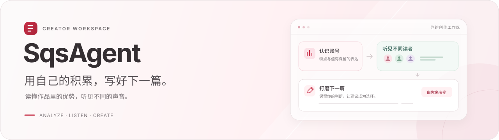
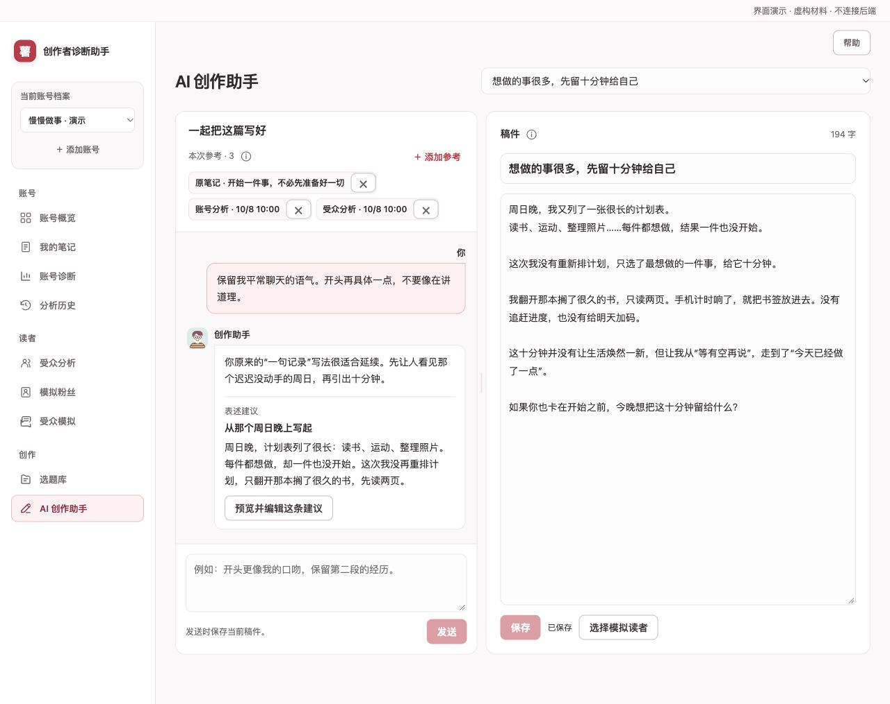
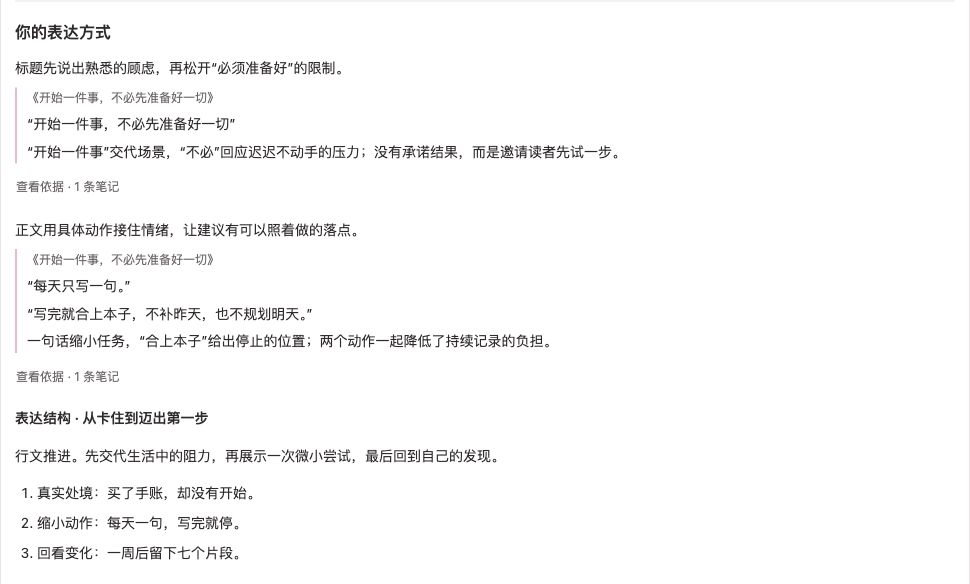
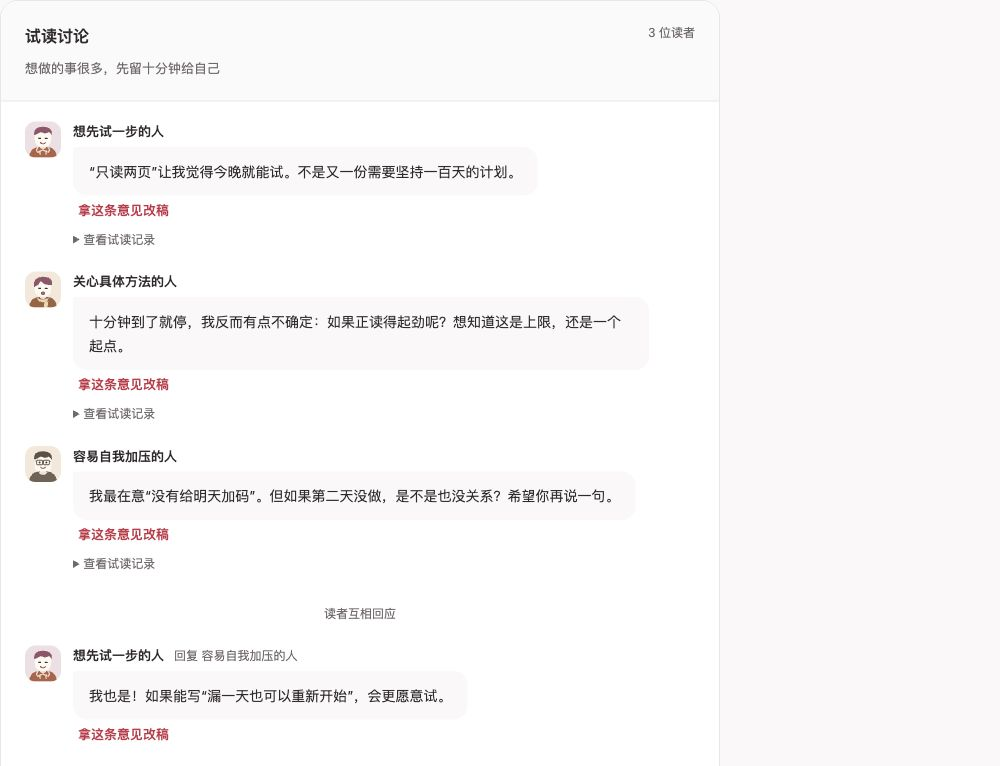

<div align="center">

[](sqsagent-promo.mp4)

**从你的旧笔记认识写法，让不同读者试读，再一起打磨下一篇。**

面向小红书创作者的 AI 内容工作区。

**[▶ 观看产品短片 · 42 秒](sqsagent-promo.mp4)**

[看看界面](#界面一览) · [选择体验方式](#开始体验) · [本地运行](#快速开始) · [阅读文档](docs/README.md)

<sub>本地保存 · 默认 Qwen · 自选参考 · 人工采用</sub>

</div>

---

## 复盘、试读和创作

SqsAgent 把笔记、分析、模拟读者和稿件放在同一个工作区。你可以先复盘，也可以直接试读或写稿，不必走完一套固定流程。

| 想做什么 | 在这里怎么做 |
| --- | --- |
| **看见作品里的优势** | 自选笔记，先认识账号，再精读代表作。原标题、原句和结构拆解放在一起，阅读结果分阶段出现 |
| **听听不同的声音** | 从受众候选中收录读者，针对账号、已发布笔记或当前创作组一个试读群；听独立意见，也能继续追问 |
| **把想法写成稿件** | 给一个创作助手选好原笔记与分析参考，左边聊、右边写；预览建议、局部改写，自己决定采用和保存 |

**AI 提供分析和建议，你决定收录谁、写什么、采用哪些修改。** 每个账号的材料与历史独立保存。

## 界面一览

以下为当前产品组件与虚构材料的界面演示，点击图片可看大图。

### 一个助手，一份你自己掌握的稿件

原笔记、账号分析、受众分析，都可以加入本次参考。只想写某个方向，就只选相关材料；不添加参考时，从当前稿件和这段对话开始。

[](docs/assets/readme/writing-assistant.jpg)

### 先读懂作品，再听听读者

<table>
<tr>
<td width="50%" valign="top">

**账号报告 · 原句旁边，就能看到解读**

从关键词和优势，读到标题、具体表达与正文组织。继续点开，可以回看当时选中的笔记。

[](docs/assets/readme/account-analysis.jpg)

</td>
<td width="50%" valign="top">

**读者群聊 · 不同关注点，放在一起聊**

有人想找方法，有人更在意代价。先听各自的意见，再看彼此回应；作者也能下场追问。

[](docs/assets/readme/reader-panel.jpg)

</td>
</tr>
</table>

试读可以用于三个场景：**账号**找后续方向，**已发布笔记**复盘同类内容，**当前创作**讨论具体修改。模拟读者由你收录和选择，不等同于真实粉丝意见或流量预测。

---

## 开始体验

| 你的情况 | 从这里开始 |
| --- | --- |
| **已有协作者发来的数据包** | 安装主应用后，按[数据交接指南](docs/data-handoff.md)恢复笔记、封面和历史，无需重装爬虫或重新抓取 |
| **第一次使用，想分析自己的账号** | 完成下方快速开始，再按[主页导入指南](docs/local-installation.md#2-安装抓取依赖)安装抓取依赖，添加自己的账号 |
| **已有四份示例档案，想快速演示** | 安装[12 条预写示例](docs/oracle-showcases.md#打开方式)，从各档案的正常分析／模拟历史进入；查看不调用模型 |

Git 只提供代码，首次启动是空工作区。预写示例需要已有的 QSheep、秀才加点冰、Ag、一粒鱼档案，不附带这些账号的数据。

## 快速开始

以下为 macOS / Linux 的主应用启动方式。需要 **Python 3.11+**、**Node.js 22.12+（22.x）** 和 Git；完整安装及抓取环境见[本地安装指南](docs/local-installation.md)。

### 1. 获取代码，安装依赖

```bash
git clone https://github.com/tuteng0915/XHS-Creator-Assistant.git
cd XHS-Creator-Assistant
python3 -m venv backend/.venv
backend/.venv/bin/python -m pip install './backend[dev]'
npm --prefix frontend ci
```

### 2. 配置模型

在仓库根目录新建 `.env.local`，填入自己的密钥：

```dotenv
MODEL_PROVIDER=qwen
QWEN_API_KEY=你的密钥
QWEN_MODEL=qwen-plus
ACCOUNT_DIAGNOSIS_PROVIDER=deepseek
DEEPSEEK_API_KEY=你的DeepSeek密钥
DEEPSEEK_MODEL=deepseek-flash
```

账号诊断默认使用 DeepSeek V4.1 Flash 非思考模式，整体阅读后并行精读代表作，再汇总报告；读者反馈与诊断内选题使用同一模型，其余功能保持 Qwen。旧报告无需重新生成；也可显式切回 Qwen。密钥仅由后端读取，`.env.local` 已被 Git 忽略。更多设置见[模型配置](docs/development.md#模型配置)。

### 3. 启动应用

终端一，从仓库根目录启动后端：

```bash
cd backend
.venv/bin/uvicorn app.main:app --reload --host 127.0.0.1 --port 8000
```

终端二，从仓库根目录启动前端：

```bash
npm --prefix frontend run dev -- --host 127.0.0.1
```

打开 **[http://127.0.0.1:5173](http://127.0.0.1:5173)**。

> [!NOTE]
> 主页导入需要额外安装 MediaCrawler 及本项目适配补丁；查看已有数据不需要。扫码窗口在运行后端的电脑打开，完整步骤见[安装指南](docs/local-installation.md)。

## 面向本地使用的轻量架构

`React + TypeScript` · `FastAPI` · `LangGraph` · `SQLite` · `Qwen`

账号诊断与读者群聊使用各自的 LangGraph 流程；创作助手每次由一个写作 Agent 回应，只读取当前稿件、当前对话段和作者选择的参考。前后端通过 HTTP／SSE 通信，内容与历史保存在本地 SQLite 和文件目录。

```text
frontend/   React + TypeScript：创作者界面与结果呈现
backend/    FastAPI + SQLite + LangGraph：数据、模型调用与协作流程
scripts/    导入适配、离线工具与验证脚本
docs/       安装、设计、架构与迭代记录
data/       本地数据库、上传文件与运行数据（不进入 Git）
```

> [!IMPORTANT]
> 当前面向本地单用户使用，没有登录认证和多租户隔离，不应直接暴露到公网。生成分析或内容时，相关材料会发往配置的模型服务；本地保存不等于离线推理。MediaCrawler 的使用范围需另行遵守其许可与平台规则。

## 深入阅读

| 文档 | 适合什么时候看 |
| --- | --- |
| [本地安装与排障](docs/local-installation.md) | 第一次运行，或配置主页导入、浏览器登录 |
| [数据交接](docs/data-handoff.md) | 把现有账号、笔记、作品与历史交给协作者 |
| [开发与验证](docs/development.md) | 调整模型配置、运行测试、做小规模复现 |
| [产品需求](docs/product-requirements.md) | 了解当前功能、交互决定与边界 |
| [Agent 与上下文架构](docs/agent-runtime-architecture.md) | 理解协作、任务上下文和持久化方式 |
| [当前进展与待办](docs/status-and-todo.md) | 区分已实现、已验证和仍待改进的部分 |

更多专题设计与历史资料见[完整文档导航](docs/README.md)。

<div align="center">

<sub>认识账号 · 听见读者 · 保留自己的表达</sub>

</div>
