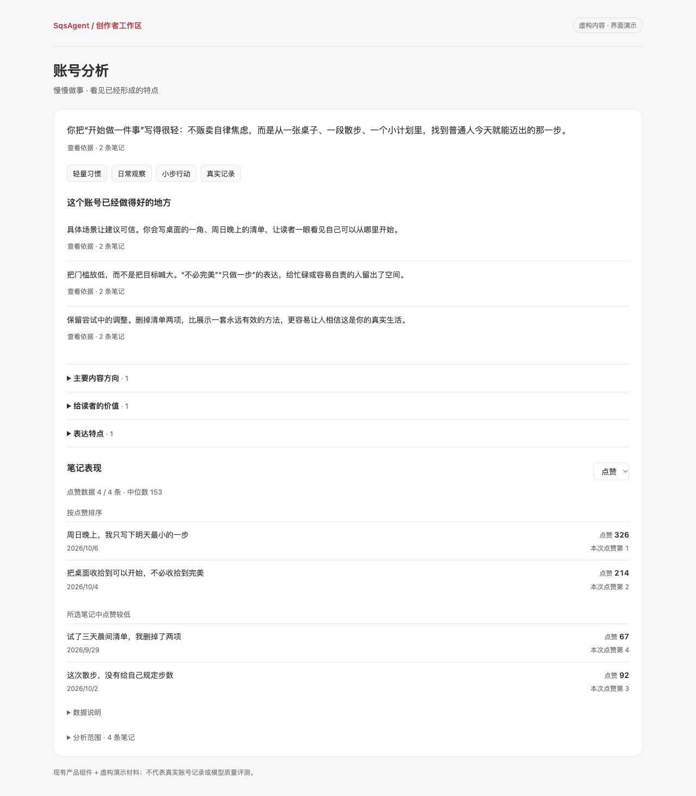
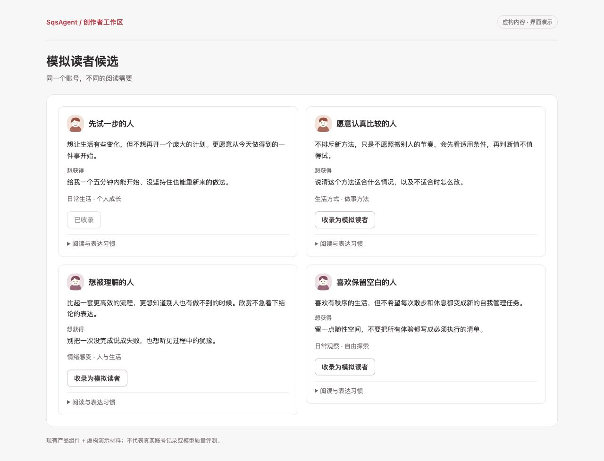
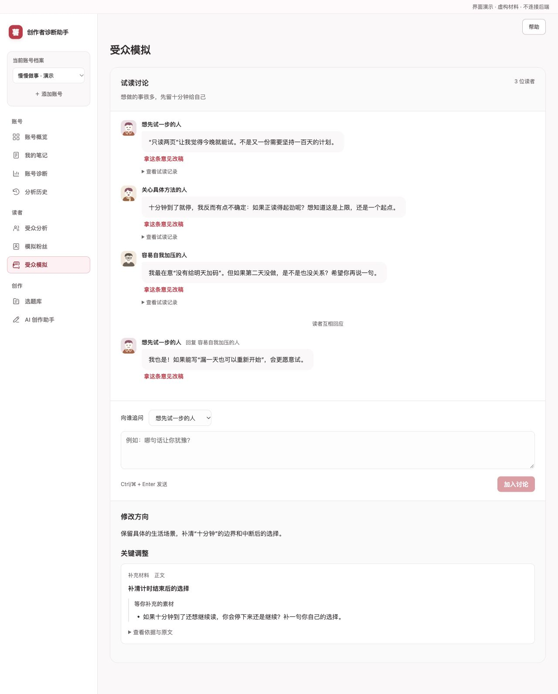

<div align="center">


面向小红书创作者的内容工作区 · 账号复盘 · AI 共创 · 模拟读者群聊

`React + TypeScript`　`FastAPI`　`LangGraph`　`SQLite`　`Qwen`

[界面一览](#界面一览) · [快速开始](#快速开始) · [交接已有数据](docs/data-handoff.md) · [文档导航](docs/README.md)

</div>

---

## 不只是帮你写下一篇

SqsAgent 把账号积累、内容创作和读者反馈放进同一个工作区。先从已有笔记认识你的表达与优势，再一起打磨选题、写稿，最后邀请不同视角的模拟读者来试读。

AI 提供分析、候选与建议；**哪些读者值得收录、哪些选题值得写、哪些修改值得采用，由创作者决定。**

| 你想做什么 | 工作区如何帮你 |
| --- | --- |
| 认识自己的账号 | 导入笔记，梳理关键词、具体优势与内容表现，回看分析依据 |
| 找到不同的声音 | 生成人物候选，关注阅读需求、判断方式和表达差异，逐位收录 |
| 把想法写成作品 | 管理选题，在画布中与研究、写作、审稿角色协作；建议先预览再采用 |
| 听听读者会怎么想 | 选择账号、已发布笔记或当前创作，推荐或手选读者，进入群聊并由作者追问 |
| 把反馈用到下一步 | 账号与已发布笔记复盘可提取后续选题；创作试读可用于修改当前稿件 |

每个账号有独立的材料与历史。模拟人物的反应用于启发创作，不代表真实粉丝意见，也不预测流量。

## 界面一览

想亲自点一遍？[四份档案内的预写示例](docs/oracle-showcases.md#打开方式)使用 QSheep、秀才加点冰、Ag、一粒鱼的已存笔记，在原有分析、受众和模拟历史中展示。查看不调用模型，喜欢的读者与选题仍由你手动收录。

以下为**现有组件 + 虚构演示内容**的界面示例，不含真实账号数据，也不是模型效果评测。点击图片可查看原图。

### 01 · 先看见账号的特点

概要、关键词和具体优势先呈现，依据与更多细节按需展开。

[](docs/assets/readme/account-analysis.jpg)

<details>
<summary><strong>02 · 认识不同的读者</strong> — 展开查看人物候选卡</summary>

兴趣可以相近，需求和判断方式各不相同。喜欢哪位，再手动收录。

[](docs/assets/readme/audience-readers.jpg)

</details>

<details>
<summary><strong>03 · 把试读变成一场对话</strong> — 展开查看读者群聊</summary>

听每位读者的独立意见，再看彼此回应；作者也可以下场追问。

[](docs/assets/readme/reader-panel.jpg)

</details>

---

## 快速开始

以下为 macOS / Linux 的主应用启动方式。需要 **Python 3.11+**、**Node.js 22.12+（22.x）** 和 Git；完整安装及抓取环境见[本地安装指南](docs/local-installation.md)。

### 1. 获取代码，安装依赖

```bash
git clone https://github.com/tuteng0915/XHS-Creator-Assistant.git
cd XHS-Creator-Assistant
python3 -m venv backend/.venv
backend/.venv/bin/python -m pip install './backend[dev]'
npm --prefix frontend ci
```

### 2. 配置模型

在仓库根目录新建 `.env.local`，填入自己的密钥：

```dotenv
MODEL_PROVIDER=qwen
QWEN_API_KEY=你的密钥
QWEN_MODEL=qwen-plus
```

默认使用 Qwen / DashScope；密钥由后端读取，不放进前端。`.env.local` 已被 Git 忽略。自定义端点、超时及兼容配置见[模型配置](docs/development.md#模型配置)。

### 3. 启动两个终端

终端一，从仓库根目录启动后端：

```bash
cd backend
.venv/bin/uvicorn app.main:app --reload --host 127.0.0.1 --port 8000
```

终端二，从仓库根目录启动前端：

```bash
npm --prefix frontend run dev -- --host 127.0.0.1
```

打开 **[http://127.0.0.1:5173](http://127.0.0.1:5173)**。

首次启动是空工作区。你可以[恢复协作者交付的数据包](docs/data-handoff.md)，或安装抓取依赖后从自己的主页开始导入。

> **主页导入是可选安装项。** Git clone 不包含 MediaCrawler，也不包含账号数据或登录态。需要在线导入时，请按[抓取依赖安装步骤](docs/local-installation.md#2-安装抓取依赖)配置固定版本及补丁；扫码窗口会在运行后端的电脑打开。查看已有数据不需要安装它。

## 把现有数据交给协作者

**代码走 Git，数据包私下发送。** 轻量交付只需数据库和上传文件，不搬运庞大的爬虫环境，也不必重新抓取已有账号。

[数据交接指南](docs/data-handoff.md)包含打包、恢复、可选的可信密钥交付和恢复检查。已有数据不要直接覆盖；小红书登录态不随包迁移。

## 项目结构

```text
frontend/   React + TypeScript：创作者界面与结果呈现
backend/    FastAPI + SQLite + LangGraph：数据、模型调用与协作流程
scripts/    导入适配、离线工具与验证脚本
docs/       安装、设计、架构与迭代记录
data/       本地数据库、上传文件与运行数据（不进入 Git）
index.html  早期单文件原型，仅作历史参考
```

前后端通过 HTTP 与 SSE 交换数据；模型调用统一从后端发起。当前面向本地单用户使用，**没有登录认证和多租户隔离，不应直接暴露到公网**。MediaCrawler 的使用范围需另行遵守其许可与平台规则。

## 深入阅读

| 文档 | 适合什么时候看 |
| --- | --- |
| [本地安装与排障](docs/local-installation.md) | 第一次运行，或配置主页导入、浏览器登录 |
| [数据交接](docs/data-handoff.md) | 把现有账号、笔记、作品与历史交给协作者 |
| [开发与验证](docs/development.md) | 调整模型配置、运行测试、做小规模复现 |
| [离线导入与兼容脚本](docs/offline-import.md) | 使用旧 JSON、MediaCrawler 输出或带封面的离线包 |
| [产品需求](docs/product-requirements.md) | 了解当前功能、交互决定与边界 |
| [Agent 与上下文架构](docs/agent-runtime-architecture.md) | 理解协作、任务上下文和持久化方式 |
| [当前进展与待办](docs/status-and-todo.md) | 区分已实现、已验证和仍待改进的部分 |

更多专题设计与历史资料见[完整文档导航](docs/README.md)。

<div align="center">

**从账号积累出发，把下一篇的决定留给你。**

</div>
