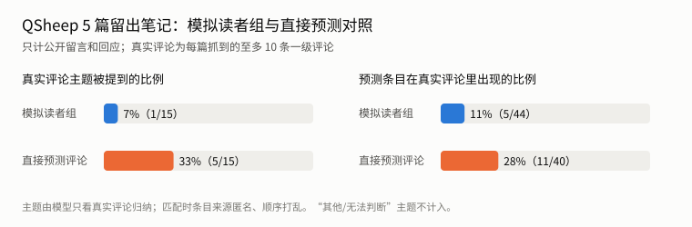
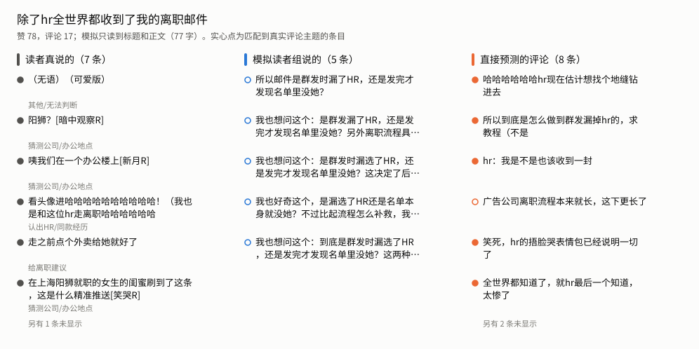
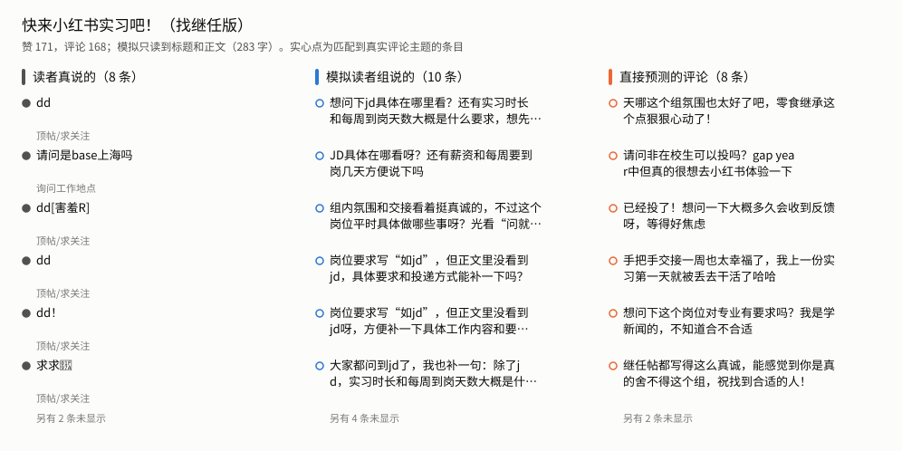

# 读者模拟回测：模拟留言与真实评论对照（2026-11-08）

用已经发布的笔记检验读者模拟：只给发布前就有的标题和正文，看模拟读者说的话是否接近真实读者在评论区说的话，以及能否分出哪篇互动更高。

- 用户批准的方案 A，调用上限 140 次，实际用了 134 次 DeepSeek（`deepseek-flash`，非思考）请求。
- 没有改业务代码。开发库只读复制到临时目录后运行，结束后核对开发库哈希未变。
- 图和标注抽查表在`docs/assets/reader-simulation-backtest-20261108/`；完整运行记录`report.json`在`data/evals/reader-simulation-backtest-20261108/`（`data/`不入库，只在本地）。复现命令见文末。

## 结论

- **模拟读者组没有复现真实评论的内容。** QSheep 的 5 篇留出笔记共 15 个真实评论主题，模拟读者组的公开留言和回应只提到 1 个，44 条中只有 5 条落在真实主题里，而且这 5 条都来自同一篇招聘帖（读者问投递方式）。
- **同样输入下，直接让模型预测评论更接近。** 一次调用预测 8 条评论，覆盖了 15 个主题中的 5 个，40 条中有 11 条落在真实主题里。
- **差距主要来自留言方式。**
  - 模拟读者的 39 条公开留言全部是提问，大多在追问正文没写的信息：JD 在哪、薪资、实习时长、安装步骤、标题说“测评”但正文没有对比等。
  - 46 条读者间回应中有 17 条以“同问”“我也想问”开头，基本重复别人的问题。
  - 真实评论 36 条里只有 6 条是提问，其余是顶帖（“dd”）、收藏标记、前同事怀念团队、玩笑、猜公司等。直接预测的 40 条里有 11 条是提问。
- **排序一致性无法判断。**
  - 模拟读者 50 次初读中 41 次立场是“犹豫”，只有 5 次是“喜欢”，各篇之间几乎没有差别。
  - 直接预测给出的互动水平也只有 6 和 7 两种值。
  - 每个账号只有 5 篇，这两组输出算出的 Spearman 相关不能说明能否排序。
- **运行本身稳定。** 134 次请求全部 HTTP 200、正常结束，没有超时或格式失败。单次请求中位 2.6 秒、最长 12.0 秒；每篇的读者组讨论（初读、回应、汇总）用时 20～30 秒。

模拟读者组在当前设定下更像“读完找缺口的审稿人”，不适合直接对外宣称为“预测评论区会说什么”。它指出的缺口不少是真问题（例如招聘帖没写投递方式），但也有相当一部分来自只给了文字：JD、截图和对比结果在图片里，模拟读者读不到，于是反复追问。

## 1. 样本与防泄露

| 账号 | 用途 | 笔记 | 说明 |
|---|---|---|---|
| QSheep | 覆盖率、命中率、排序 | 聊聊文科生怎么找AI实习、Codex画图skill整理、阿里千问C招AI产品运营增长实习生、快来小红书实习吧（找继任版）、除了hr全世界都收到了我的离职邮件 | 都不在生成这 5 位读者的受众分析（`2416d168`）输入中，读者历史也没有引用它们 |
| 一粒鱼 | 只做排序 | 提前批上岸港大MKT文书、金融PhD锐评英国Top金融硕士、美国顶尖商学院偏爱的学生画像、商科生可以申请的AI硕士测评、27fall必看港大金融项目录取背景参考 | 10 篇笔记只有 4 条评论，算不了评论指标 |

- 读者初读的提示里会带每位读者的历史案例（旧笔记节选，加上至多 2 条真实评论），所以目标笔记出现在历史里就等于泄露答案。
  - QSheep 的读者历史只引用了 3 篇旧笔记，与测试笔记无关。
  - 一粒鱼的读者历史引用了 7 篇笔记。每篇测试前，在临时库的本次模拟快照里删掉引用该篇的历史和证据，5 篇共删 5 条。
- 每个账号固定一组 5 位读者：QSheep 用现有的 5 位，一粒鱼用 10-07 生成的 5 位。不调用选人环节。
- 模拟只读到标题和正文，没有图片、互动数据和账号定位。
- 真实评论来自 10-01 的抓取包，每篇至多抓 10 条一级评论，并去掉作者本人的回复。5 篇共 36 条读者评论。

## 2. 方法

每篇笔记三组调用：

1. **模拟读者组**：现行工作流，自然阅读，开启读者互相回应。包括 5 次初读、至多 5 次回应和汇总（含审核共 1～2 次）。
2. **对照：直接预测**：同一份标题和正文，一次调用列出 8 条最可能出现的一级评论，并给出 1～10 的互动水平。
3. **标注（仅 QSheep）**：
   - 第一次只给真实评论，按“读者在说什么”归纳主题。
   - 第二次把模拟和对照的条目匿名、打乱顺序，逐条判断属于哪个主题，或者不属于任何主题。

指标：

- **覆盖率**：真实评论主题中，至少有一条预测落在其中的比例。“其他／无法判断”不计。
- **命中率**：预测条目中落在某个真实主题里的比例。
- 模拟读者组的主指标只计公开留言和回应；把未公开的顾虑也算进去，结果见下表的“含顾虑”列。
- **排序一致性**：模拟中立场为“喜欢”的读者比例、选择留言的读者比例、对照给出的互动水平，分别与“赞＋藏”求 Spearman 相关。

## 3. 结果



| 笔记 | 读者评论 | 主题 | 模拟：覆盖 | 模拟：命中 | 对照：覆盖 | 对照：命中 |
|---|---|---|---|---|---|---|
| 聊聊文科生怎么找AI实习 | 9 | 5 | 0/5 | 0/10 | 2/5 | 3/8 |
| Codex画图skill整理 | 7 | 3 | 0/3 | 0/9 | 0/3 | 0/8 |
| 阿里千问C招AI产品运营增长实习生 | 5 | 1 | 1/1 | 5/10 | 0/1 | 0/8 |
| 快来小红书实习吧（找继任版） | 8 | 2 | 0/2 | 0/10 | 1/2 | 1/8 |
| 除了hr全世界都收到了我的离职邮件 | 7 | 4 | 0/4 | 0/5 | 2/4 | 7/8 |
| **合计** | 36 | 15 | **1/15（7%）** | **5/44（11%）** | **5/15（33%）** | **11/40（28%）** |

- 把模拟读者未公开的顾虑也算进去，条目增至 84 条，命中 7 条（8%），覆盖仍是 1/15。
- 模拟读者组唯一命中的主题是千问招聘帖的“求投递方式”。真实读者在这篇下几乎只问这一件事，模拟读者也都发现正文没写投递方式。
- 直接预测命中较多的是离职邮件一篇：真实评论多是玩笑，直接预测也写成玩笑，而模拟读者都在追问“是群发漏了 HR 还是名单里没有她”。





### 排序

| 账号 | “喜欢”比例 | 留言比例 | 对照互动水平 |
|---|---|---|---|
| QSheep（5 篇） | 0.21 | 0.34 | 0.71 |
| 一粒鱼（5 篇） | −0.71 | −0.71 | 0.00 |

- 表中是与“赞＋藏”的 Spearman 相关。
- 模拟读者的“喜欢”比例在 10 篇中有 6 篇为 0。对照的互动水平只有 6 和 7 两种，并列很多。
- 这些相关系数主要由并列和个别点决定，不能作为能否排序的证据。

## 4. 局限

- **样本少**：评论指标只有 1 个账号、5 篇、36 条读者评论、15 个主题。排序每个账号只有 5 篇。
- **真实评论不完整**：每篇至多抓 10 条一级评论，覆盖率是相对抓到的样本算的。例如小红书实习继任帖实际有 168 条评论，这里只用到 8 条，且大多是“dd”。
- **模拟只看文字**：几篇笔记的关键信息在图片里（JD、对比图），真实读者看得到，模拟读者看不到。模拟读者组的一部分追问由此产生；对照也只看文字，但它预测的是评论区的语气，受影响较小。
- **真实评论受账号社交关系影响**：比如前同事来怀念团队、熟人猜公司，这类评论从正文无法推出，两种方法都难以覆盖。
- **标注由模型完成**：主题归纳和匹配都由同一个模型完成，标准可能偏宽或偏严。抽查表见[labelling-samples.md](assets/reader-simulation-backtest-20261108/labelling-samples.md)。用户决定按演示用途收尾，没有做人工抽查，本文所有覆盖率和命中率都是未经人工复核的模型判定。
- **对照组条数固定为 8 条**，与模拟读者组的公开条目数（每篇 5～10 条）相近。条数会影响覆盖率和命中率之间的取舍。

## 5. 对产品与演示的含义

- 不宜把读者模拟展示为“预测评论区”。更接近事实的说法是：几位设定不同的读者读完文字后，各自还缺什么信息、会追问什么。
- 如果要让模拟更接近真实评论区，可以考虑的方向（未验证，需要单独评估）：
  - 读者模拟提示中减少“找缺口”的倾向。现在提示要求写 concerns，留言也多由顾虑转成。
  - 让模拟读到图片里的文字。
  - 限制回应环节里“同问”式的重复。
- 本次只说明“在这 5 篇上没有复现真实评论”，不能说明读者模拟对写作改稿没有帮助；后者需要另外设计评估。

## 6. 第二轮：只改提示词（未采用）

用户批准上限 202 次，实际 188 次 DeepSeek 请求，全部 HTTP 200，开发库未变。调参集打分（再用 5 次）在收尾时取消，下表只有验证集。

- 改动：初读提示把内部顾虑与公开留言分开，并列出提问以外的留言类型；回应提示要求不重复别人的问题。
- 验证集：5 篇评论较多的留出笔记，48 条真实评论，22 个主题。读者由其余 25 篇另行生成，泄露检查为 0。

| | 覆盖主题 | 命中 | 提问占比 |
|---|---|---|---|
| 现行提示词 | 4/22 | 11/39（28%） | 82% |
| 改后提示词 | 4/22 | 5/37（14%） | 76% |
| 直接预测 | 8/22 | 18/40（45%） | 23% |

真实评论的提问占比是 23%。改后没有改善，回应对象为空的情况反而增多（6/49，现行提示词 1/24），10 次运行中有 6 次只部分完成（现行提示词 5 次中 1 次）。用户决定撤回，两段提示词已恢复原样。

逐篇看到的情况：

- 模拟读者在真实读者也提问的帖子上表现较好（千问招聘、IAMCR、中传-LSE），在喜报、吐槽、生活分享和收藏类帖子上几乎说不中。
- 相同句式跨篇重复，例如“松了口气，原来不是只有我”“今天先做哪一步”，说明留言更多受读者画像驱动，而不是帖子场合。这一点没有单独验证。
- 命中率对判定口径敏感。若“恭喜！不过……”这类先祝贺再追问的留言也算说中，现行提示词的命中率约 44%，和直接预测接近；提问占比过高的结论不受影响。
- 直接预测命中的条目里有不少是泛泛的夸奖和祝贺，说明它猜中的主要是评论区气氛。

后续方向：用户决定改为“评论区预览”，把生成改成从 tag 库中选择反应类型，再按 tag 写留言。现有读者模拟保留用于改稿反馈。

## 复现

```bash
# 不发请求，只用演示读者跑通流程
backend/.venv/bin/python scripts/backtest_reader_simulation.py --output /tmp/backtest-dry
# 真实运行（需要本地 DeepSeek 凭据；上限 140 次请求，超出即停）
backend/.venv/bin/python scripts/backtest_reader_simulation.py --live --output data/evals/reader-simulation-backtest-20261108
# 只用已保存的报告重新计分、出图和生成抽查表
backend/.venv/bin/python scripts/backtest_reader_simulation.py --score-only --output data/evals/reader-simulation-backtest-20261108
backend/.venv/bin/python scripts/backtest_reader_simulation.py --render --output data/evals/reader-simulation-backtest-20261108 \
  --assets docs/assets/reader-simulation-backtest-20261108
# 第二轮（提示词已撤回，运行 old/new 需要分别对应两版提示词）
backend/.venv/bin/python scripts/backtest_reader_simulation_round2.py --phase score --output data/evals/reader-simulation-backtest-round2-20261108
```

`report.json`保存了每次请求的完整输入、模型原文、用时和 token 用量，不含凭据。
